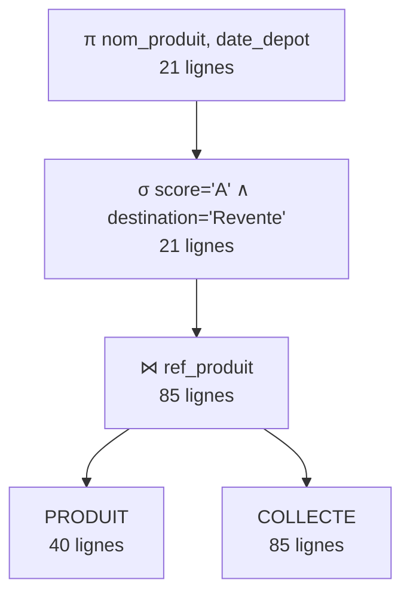
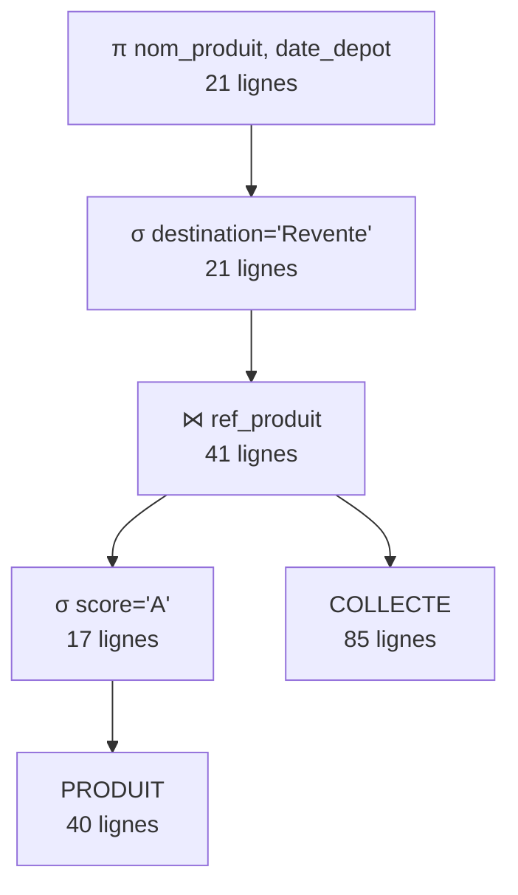
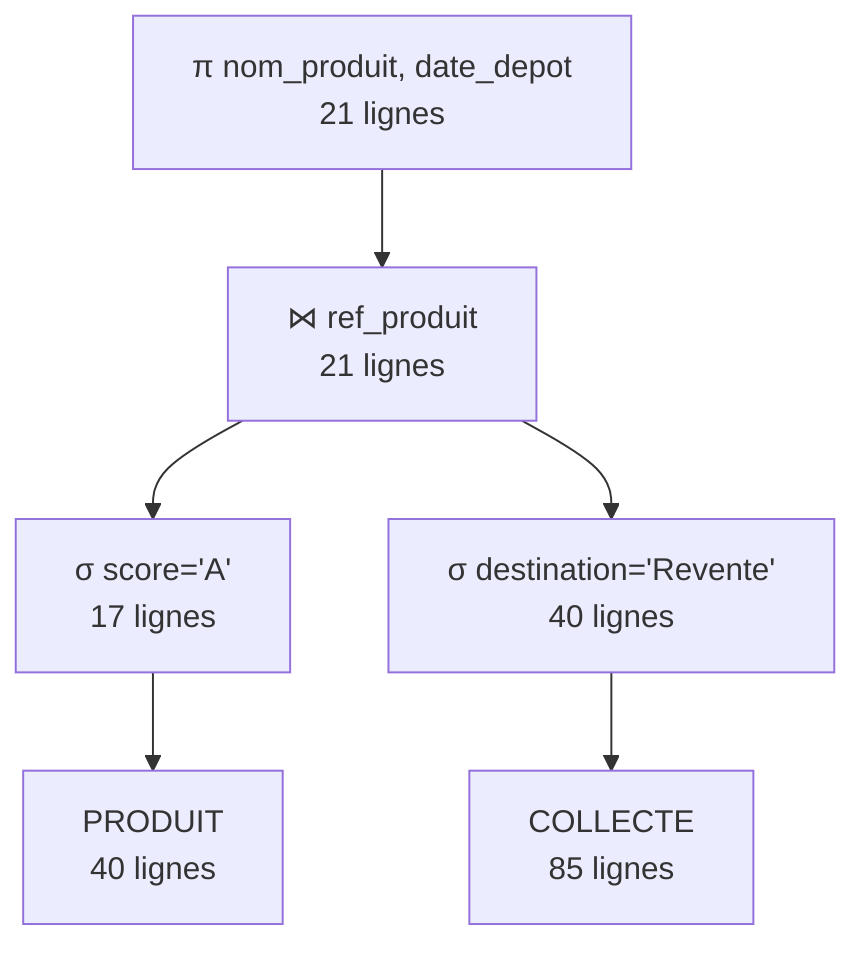

# Etam Seconde Vie — Mini-projet Bases de données (TI503N)

## 1. Analyse des besoins

### 1.1 Choix du domaine

Nous avons choisi la mode circulaire appliquée à une entreprise réelle : Etam, marque française de lingerie, nuit, homewear et bain. Etam mène un programme RSE (*We Care*) qui inclut des matières recyclées ou bio, la traçabilité des fournisseurs et la collecte de pièces en magasin pour leur donner une seconde vie (revente, recyclage, upcycling). Ce domaine se prête bien à une base de données : beaucoup d'entités liées, des données chiffrées (empreinte carbone, pourcentages, prix) et des règles de gestion précises.

### 1.2 Prompt utilisé

Le prompt complet est dans [`prompts/1_prompt_analyse_besoins.txt`](prompts/1_prompt_analyse_besoins-2.txt). Il reprend mot pour mot la base de prompt fournie : nous avons complété les parties entre crochets et ajouté quelques éléments (un paragraphe de contexte, des précisions sur la forme des règles de gestion et sur le tableau). Correspondance avec le framework RICARDO :

| Lettre | Où dans le prompt |
|---|---|
| R — Rôle | Base fournie : « Tu es chargé de la partie analyse... », dans une entreprise de lingerie comme Etam |
| I — Instructions | Base fournie : d'abord les règles de gestion, ensuite le dictionnaire |
| C — Contexte | Parties complétées (domaine, activité, exemples Etam / Undiz / Princesse tam.tam, données collectées) + paragraphe ajouté : catégories sur plusieurs niveaux, tailles/couleurs, composition matière + fournisseur, collecte seconde vie |
| A — Contraintes additionnelles | Base fournie (25 à 35 données, sans a priori de modélisation) + précisions ajoutées : règles numérotées, « un seul / plusieurs / au plus un », formats, pas de donnée calculable |
| R — Références | 5 liens : pages *We Care* d'Etam, communiqués de presse (corner seconde main, bilan 2021), article FashionUnited |
| D — Rendement désiré | Base fournie (liste à puces + tableau) + précisions ajoutées : colonne avec le nom court de la donnée, types autorisés |
| O — Objectif | Base fournie : fournir à l'étudiant ce qu'il faut pour concevoir ensuite la base lui-même |

### 1.3 Règles de gestion (réponse de l'IA)

Catégories et collections
- RG01 — Chaque catégorie a un libellé, qui ne peut pas être utilisé par deux catégories.
- RG02 — Une catégorie peut être la sous-catégorie d'au plus une catégorie mère ; une catégorie mère peut avoir zéro ou plusieurs sous-catégories (ex. : Lingerie > Soutiens-gorge > Push-up).
- RG03 — Une catégorie ne peut pas être sa propre catégorie mère.
- RG04 — Un produit appartient à une et une seule catégorie ; une catégorie contient zéro ou plusieurs produits.
- RG05 — Un produit fait partie d'une et une seule collection ; une collection regroupe zéro ou plusieurs produits. Une collection a un nom, une saison, une année et peut être labellisée « éco-conçue ».
- RG06 — La saison vaut « Printemps-Été » ou « Automne-Hiver » ; l'année est comprise entre 2015 et 2030.

Produits et variantes
- RG07 — La référence d'un produit a la forme « ET » suivie de 6 chiffres (ex. : ET652100).
- RG08 — Le prix de vente est strictement positif et inférieur à 500 €.
- RG09 — Le taux de recyclabilité d'un produit est un pourcentage entre 0 et 100.
- RG10 — Le score environnemental d'un produit va de A (meilleur) à E.
- RG11 — Un produit ne peut pas avoir été lancé avant 2015.
- RG12 — Un produit est décliné en une ou plusieurs variantes (taille + couleur). Une variante n'existe pas sans son produit et est identifiée par son numéro au sein du produit (variante 1, 2, 3... de ET652100).
- RG13 — La taille est une taille lettre (XS, S, M, L, XL, XXL), « TU » (taille unique) ou une taille de bonnet (70A à 105H).
- RG14 — Chaque variante a un code EAN-13 unique composé de 13 chiffres.
- RG15 — Le stock d'une variante est positif ou nul.

Matières, fournisseurs et composition
- RG16 — Une matière a un nom unique, un type de fibre, un indicateur « recyclée », une certification éventuelle et une empreinte carbone (kg CO2e par kg de matière).
- RG17 — Le type de fibre vaut Naturelle, Synthétique ou Artificielle.
- RG18 — La certification, si elle existe, fait partie de : GOTS, OEKO-TEX, GRS, RCS, FSC.
- RG19 — Une matière recyclée doit être certifiée GRS ou RCS.
- RG20 — L'empreinte carbone est positive ou nulle.
- RG21 — Un fournisseur a une raison sociale, un pays, un e-mail unique et une date de début de partenariat.
- RG22 — Les e-mails respectent le format `texte@domaine.extension`.
- RG23 — Un produit est composé d'une ou plusieurs matières, chacune achetée auprès d'un fournisseur, pour un pourcentage donné. Une même matière d'un même produit peut venir de plusieurs fournisseurs, chacun pour une part (ex. : le coton bio du shorty *Daily* vient pour 46 % de Gujarat Fibres et pour 46 % de Tiruppur Organic Cotton). Une matière ou un fournisseur peut n'intervenir dans aucun produit.
- RG24 — Un pourcentage de composition est strictement positif et au plus égal à 100.
- RG25 — La somme des pourcentages de composition d'un produit ne dépasse pas 100 % (elle vaut 100 % quand la composition est complète).

Magasins et clientes
- RG26 — Un magasin a un nom, une ville, un type et une date d'ouverture.
- RG27 — Le type de magasin vaut Boutique, Corner ou Outlet.
- RG28 — Une cliente fidélité a un nom, un prénom, un e-mail unique, un téléphone facultatif, une date de naissance, une ville, une date d'inscription et un solde de points.
- RG29 — L'e-mail de la cliente respecte le format e-mail (RG22).
- RG30 — Le téléphone, s'il est renseigné, compte 10 chiffres et commence par 0 suivi d'un chiffre de 1 à 9.
- RG31 — Une cliente a au moins 15 ans à la date de son inscription.
- RG32 — Les points de fidélité sont positifs ou nuls.

Commandes
- RG33 — Une commande est passée par une et une seule cliente ; une cliente passe zéro ou plusieurs commandes.
- RG34 — Le canal vaut Web ou Magasin ; le statut vaut En cours, Expédiée, Livrée ou Annulée.
- RG35 — Une commande web n'est rattachée à aucun magasin ; une commande magasin est enregistrée dans au plus un magasin (le lien devient vide si le magasin ferme). Un magasin enregistre zéro ou plusieurs commandes.
- RG36 — Une commande contient une ou plusieurs variantes, avec une quantité et le prix unitaire réellement payé (qui peut différer du prix de vente, par exemple en période de soldes) ; une variante figure dans zéro ou plusieurs commandes.
- RG37 — La quantité d'une variante dans une commande est comprise entre 1 et 10 ; le prix unitaire est strictement positif.

Collecte seconde vie
- RG38 — Une collecte correspond au dépôt d'une pièce par une et une seule cliente, dans un et un seul magasin. Une cliente peut déposer zéro ou plusieurs pièces ; un magasin peut recueillir zéro ou plusieurs pièces.
- RG39 — Une collecte concerne un et un seul produit Etam ; un produit peut être collecté zéro ou plusieurs fois.
- RG40 — L'état de la pièce vaut Très bon, Bon, Usé ou Abîmé ; la destination vaut Revente, Recyclage ou Upcycling.
- RG41 — Une pièce abîmée ne peut pas partir en revente.
- RG42 — Le bon d'achat remis à la cliente est compris entre 0 et 15 €.
- RG43 — Le dispositif de collecte existe depuis 2021 : aucune collecte n'est antérieure au 1er janvier 2021.

### 1.4 Dictionnaire de données brutes (réponse de l'IA)

35 données, conformément à la consigne (entre 25 et 35), sans identifiant ni rattachement à une entité.

| Code | Signification | Type | Taille |
|---|---|---|---|
| libelle_categorie | Nom d'une catégorie du catalogue | Alphanumérique | 50 |
| nom_collection | Nom de la collection | Alphanumérique | 50 |
| saison | Saison de la collection | Alphabétique | 20 |
| annee | Année de la collection | Numérique | 4 |
| ref_produit | Référence du produit (ET + 6 chiffres) | Alphanumérique | 8 |
| nom_produit | Nom commercial du produit | Alphanumérique | 80 |
| prix_vente | Prix de vente TTC en euros | Numérique | 6 (dont 2 décimales) |
| date_lancement | Date de mise en vente du produit | Date | 10 |
| score_environnemental | Score environnemental (A à E) | Alphabétique | 1 |
| taille | Taille de la déclinaison | Alphanumérique | 5 |
| couleur | Couleur de la déclinaison | Alphabétique | 30 |
| code_ean | Code-barres EAN-13 de la déclinaison | Alphanumérique | 13 |
| nom_matiere | Nom de la matière | Alphabétique | 50 |
| type_fibre | Type de fibre (naturelle, synthétique, artificielle) | Alphabétique | 15 |
| est_recyclee | La matière est-elle recyclée ? | Booléen | 1 |
| certification | Label de la matière (GOTS, OEKO-TEX, GRS...) | Alphanumérique | 10 |
| empreinte_carbone_kg | Empreinte carbone en kg CO2e par kg de matière | Numérique | 5 (dont 2 décimales) |
| pourcentage | Part d'une matière d'un fournisseur dans un produit | Numérique | 5 (dont 2 décimales) |
| raison_sociale | Nom du fournisseur | Alphanumérique | 80 |
| pays_fournisseur | Pays du fournisseur | Alphabétique | 50 |
| nom_magasin | Nom du magasin | Alphanumérique | 80 |
| ville_magasin | Ville du magasin | Alphabétique | 50 |
| type_magasin | Type de point de vente (boutique, corner, outlet) | Alphabétique | 10 |
| nom | Nom de la cliente | Alphabétique | 50 |
| prenom | Prénom de la cliente | Alphabétique | 50 |
| email | Adresse e-mail de la cliente | Alphanumérique | 100 |
| date_naissance | Date de naissance de la cliente | Date | 10 |
| date_commande | Date de la commande | Date | 10 |
| canal | Canal de la commande (web ou magasin) | Alphabétique | 7 |
| quantite | Quantité achetée d'une déclinaison | Numérique | 2 |
| prix_unitaire | Prix payé par unité (peut être soldé) | Numérique | 6 (dont 2 décimales) |
| date_depot | Date du dépôt d'une pièce en magasin | Date | 10 |
| etat_piece | État de la pièce déposée | Alphabétique | 10 |
| destination | Orientation de la pièce (revente, recyclage, upcycling) | Alphabétique | 10 |
| montant_bon_achat | Montant du bon d'achat remis | Numérique | 4 (dont 2 décimales) |

### 1.5 Vérification de l'adéquation du résultat

- Le dictionnaire respecte la consigne : 35 données, colonnes signification / type / taille, aucun identifiant ni regroupement en entités.
- Chaque donnée du dictionnaire est utilisée par au moins une règle de gestion.
- Aucune donnée calculable : pas de montant total de commande, pas d'âge, pas d'empreinte carbone par produit (calculée à partir de la composition).
- Les trois situations utiles à la modélisation avancée apparaissent dans les règles : catégories sur plusieurs niveaux (RG02), composition produit / matière / fournisseur (RG23), déclinaison qui n'existe pas sans son produit (RG12).
- Données ajoutées lors de la conception du MCD (autorisé par le sujet) : les identifiants (`id_categorie`, `id_collection`, `id_matiere`, `id_fournisseur`, `id_magasin`, `id_client`, `id_commande`, `id_collecte`, `num_variante`) et des données citées dans les règles mais laissées hors du dictionnaire pour rester sous 35 : `eco_concue`, `pays_confection`, `taux_recyclabilite`, `stock`, `email_fournisseur`, `date_debut_partenariat`, `date_ouverture`, `telephone`, `ville`, `date_inscription`, `points_fidelite`, `statut`.

---

## 2. MCD

Fichier source : [`mcd/etam_seconde_vie.mcd`](mcd/etam_seconde_vie.mcd)


Éléments de modélisation avancée :

| Élément | Où | Pourquoi ce choix |
|---|---|---|
| Association réflexive (récursive) | `SOUS_CATEGORIE_DE` sur CATEGORIE (0,1 côté fille / 0,n côté mère) | Le catalogue est un arbre de profondeur variable (Lingerie > Soutiens-gorge > Push-up). Une table par niveau serait rigide ; une seule entité reliée à elle-même gère n'importe quelle profondeur. |
| Association ternaire | `COMPOSER` entre PRODUIT, MATIERE et FOURNISSEUR, porteuse de `pourcentage` | Le pourcentage dépend des trois à la fois : un même produit peut acheter la même matière à deux fournisseurs différents, pour deux parts différentes. Deux associations binaires (produit–matière et matière–fournisseur) perdraient l'information « quel fournisseur pour quelle matière de quel produit ». |
| Entité faible / identifiant relatif | VARIANTE identifiée par `num_variante` relativement à PRODUIT via `DECLINER` (1,1 souligné) | Une variante (taille + couleur) n'existe pas sans son produit, et sa numérotation (1, 2, 3...) recommence pour chaque produit. |

Autres choix :
- `CONTENIR` est une association porteuse (quantité, prix unitaire) entre COMMANDE et VARIANTE : on vend une taille et une couleur précises, pas un produit abstrait. Le prix unitaire est stocké car il peut différer du prix de vente (soldes).
- `ENREGISTRER` (0,1 côté commande) : seules les commandes magasin sont rattachées à un magasin.
- COLLECTE est une entité (et non une association ternaire client/magasin/produit) car une même cliente peut déposer le même produit dans le même magasin plusieurs fois : il faut un identifiant propre.

Pourquoi le modèle est en 3FN :
- 1FN : tous les attributs sont atomiques (pas de liste de tailles ou de matières dans PRODUIT : elles sont dans VARIANTE et COMPOSER).
- 2FN : dans les associations à clé composée, les attributs dépendent de toute la clé (`pourcentage` dépend du triplet produit/matière/fournisseur ; `quantite` et `prix_unitaire` du couple commande/variante).
- 3FN : aucun attribut non-clé ne dépend d'un autre attribut non-clé. Par exemple, nous n'avons pas mis de code postal à côté de la ville (code postal → ville serait une dépendance transitive), ni d'âge à côté de la date de naissance, ni de montant total dans COMMANDE.

---

## 3. MLD et MPD

### 3.1 MLD

Obtenu en appliquant les règles de transformation MCD → MLD :
- 1ère règle : chaque entité devient une relation, son identifiant devient la clé primaire, son identifiant secondaire devient une clé secondaire ;
- 2ème règle : association binaire (X,1)-(X,N) → la clé primaire côté (X,N) devient clé étrangère côté (X,1) (APPARTENIR, FAIRE_PARTIE, PASSER, ENREGISTRER, DEPOSER, RECUEILLIR, CONCERNER) ;
- 3ème règle : association (X,N)-(X,N) → nouvelle relation dont la clé primaire concatène les deux clés (CONTENIR) ;
- 4ème règle : association n-aire → nouvelle relation dont la clé primaire concatène les identifiants des entités (COMPOSER) ;
- 5ème règle : association réflexive (0,1)-(0,N) → la clé primaire se dédouble en clé étrangère (SOUS_CATEGORIE_DE) ;
- entité faible : sa clé primaire est formée de la clé de l'entité forte et de son identifiant relatif (VARIANTE).

Clés primaires <u>soulignées</u>, clés étrangères précédées de #. Clés secondaires (UNIQUE) : libelle_categorie, code_ean, nom_matiere, email_fournisseur, email.

- categorie (<u>id_categorie</u>, libelle_categorie, #id_categorie_parente) — *association réflexive : 5ème règle*
- collection (<u>id_collection</u>, nom_collection, saison, annee, eco_concue)
- produit (<u>ref_produit</u>, nom_produit, prix_vente, date_lancement, pays_confection, taux_recyclabilite, score_environnemental, #id_categorie, #id_collection)
- variante (<u>#ref_produit, num_variante</u>, taille, couleur, code_ean, stock) — *entité faible*
- matiere (<u>id_matiere</u>, nom_matiere, type_fibre, est_recyclee, certification, empreinte_carbone_kg)
- fournisseur (<u>id_fournisseur</u>, raison_sociale, pays_fournisseur, email_fournisseur, date_debut_partenariat)
- composer (<u>#ref_produit, #id_matiere, #id_fournisseur</u>, pourcentage) — *association ternaire : 4ème règle de transformation*
- magasin (<u>id_magasin</u>, nom_magasin, ville_magasin, type_magasin, date_ouverture)
- client (<u>id_client</u>, nom, prenom, email, telephone, date_naissance, ville, date_inscription, points_fidelite)
- commande (<u>id_commande</u>, date_commande, canal, statut, #id_client, #id_magasin)
- contenir (<u>#id_commande, #(ref_produit, num_variante)</u>, quantite, prix_unitaire) — *association (X,N)-(X,N) porteuse d'attributs : 3ème règle de transformation*
- collecte (<u>id_collecte</u>, date_depot, etat_piece, destination, montant_bon_achat, #id_client, #id_magasin, #ref_produit)

### 3.2 MPD

- [`sql/1_creation.sql`](sql/1_creation.sql) : création des 12 tables avec les contraintes d'intégrité (PRIMARY KEY, FOREIGN KEY, NOT NULL, UNIQUE, DEFAULT).
- [`sql/2_contraintes.sql`](sql/2_contraintes.sql) : contraintes de validation ajoutées par `ALTER TABLE ... ADD CONSTRAINT`, chacune reliée à sa règle de gestion (RGxx).

Gestion des clés étrangères :

| Situation | Choix | Exemple |
|---|---|---|
| Modification d'une clé référencée | `ON UPDATE CASCADE` sur toutes les clés étrangères | Changer la référence d'un produit met à jour ses variantes, compositions, lignes de commande et collectes |
| Le fils n'a pas de sens sans le père | `ON DELETE CASCADE` | Supprimer un produit supprime ses variantes et sa composition ; supprimer une cliente (droit à l'oubli RGPD) supprime ses commandes et dépôts |
| Lien facultatif (cardinalité 0,1) | `ON DELETE SET NULL` | Supprimer une catégorie mère rend ses sous-catégories « racines » ; fermer un magasin garde l'historique de ses commandes |

Contraintes de validation (CHECK) :

| Type | Exemples |
|---|---|
| Énumération des valeurs possibles (`IN`) | saison, score A–E, type de fibre, type de magasin, canal, statut, état, destination |
| Intervalle (`BETWEEN`, `>`, `>=`) | année 2015–2030, taux 0–100, quantité 1–10, bon 0–15 €, stock ≥ 0, dates minimales |
| Format avec un masque (`LIKE`) | référence `ET______`, EAN à 13 caractères, taille, e-mail `%_@_%._%`, téléphone `0_________` |
| Fonction | au moins 15 ans à l'inscription (`YEAR`) |
| Condition sur plusieurs attributs d'une ligne | matière recyclée ⇒ certification GRS ou RCS ; pièce abîmée ⇒ pas de revente |

Règles de gestion non traduites en contrainte :
- RG03 (une catégorie n'est pas sa propre mère) et RG35 (une commande web n'a pas de magasin) : MySQL n'accepte pas de `CHECK` sur une clé étrangère qui a une action `ON DELETE` / `ON UPDATE`.
- RG25 (somme des pourcentages d'un produit ≤ 100 %) : un `CHECK` porte sur une seule ligne, alors que cette règle porte sur plusieurs lignes de `composer`.

Ces trois règles sont respectées par les données insérées et pourront être contrôlées par l'application.

---

## 4. Insertion des données

- Prompt : [`prompts/2_prompt_insertion.txt`](prompts/2_prompt_insertion.txt) (structure RICARDO : rôle, instructions, contexte, contraintes additionnelles, références, rendement désiré, objectif).
- Résultat : [`sql/3_insertion.sql`](sql/3_insertion.sql), à exécuter après les scripts 1 et 2.

| Table | Lignes | | Table | Lignes |
|---|---|---|---|---|
| categorie | 19 | | composer | 87 |
| collection | 6 | | magasin | 15 |
| produit | 40 | | client | 60 |
| variante | 116 | | commande | 130 |
| matiere | 16 | | contenir | 310 |
| fournisseur | 12 | | collecte | 85 |

Cas particuliers présents dans les données : 12 clientes sans commande, 4 produits jamais commandés, 2 magasins sans collecte, 2 matières non utilisées, 1 fournisseur sans composition, une branche de catégories (Accessoires > Pochettes lingerie) sans produit.

Vérifications faites sur le résultat de l'IA : somme des compositions = 100 % pour chaque produit, cohérence nom ↔ matière (une « nuisette soie » est bien en soie), dates de commande postérieures à l'inscription de la cliente, collectes postérieures au lancement du produit.

---

## 5. Scénario d'utilisation et requêtes

### 5.1 Scénario

Utilisatrice : Inès, chargée de mission RSE « Mode circulaire » chez Etam.

Objectif : préparer le bilan annuel We Care pour la direction et la prochaine campagne marketing « Seconde Vie » (inciter les clientes à rapporter leurs pièces en magasin).

| Besoin d'Inès | Données extraites | Requêtes |
|---|---|---|
| Mettre en avant les produits les plus responsables | Produits notés A/B, matières recyclées ou bio | A1, A5, B5 |
| Identifier les produits à éco-concevoir en priorité | Empreinte carbone pondérée par produit | B4 |
| Rendre la composition transparente (passeport produit) | Matières, fournisseurs, pays, pourcentages d'un produit | C5, D5 |
| Mesurer le dispositif seconde vie | Pièces par destination et par état, bons d'achat, collectes 2025 | A3, B1, B6 |
| Repérer les magasins moteurs et ceux à relancer | Collectes par magasin, magasins sans collecte | B2, C4 |
| Cibler la campagne | Clientes acheteuses ET déposantes, clientes sans téléphone, clientes sans commande | D2, A6, C2 |
| Suivre les ventes | CA par année et par canal, détail des ventes 2026 | B3, C1 |
| Nettoyer le catalogue | Produits jamais commandés, matières et fournisseurs inutilisés | D1, D3, C6 |

### 5.2 Requêtes

Toutes les requêtes sont dans [`sql/4_interrogation.sql`](sql/4_interrogation.sql), avec en commentaire les données recherchées.

| Type de requête | Requêtes | Techniques utilisées |
|---|---|---|
| Projections et restrictions (6) | A1 à A6 | `WHERE`, `ORDER BY`, `DISTINCT`, masques `LIKE`, `IN`, `BETWEEN`, `IS NULL` |
| Agrégation (6) | B1 à B6 | `COUNT`, `SUM`, `AVG`, `MIN`, `MAX`, `GROUP BY`, `HAVING` |
| Jointures (6) | C1 à C6 | jointure interne multiple (5 tables), `LEFT` et `RIGHT OUTER JOIN`, jointure externe complète (simulée par `UNION`, MySQL n'ayant pas `FULL OUTER JOIN`), auto-jointure (récursive), jointure sur la ternaire |
| Requêtes imbriquées (6) | D1 à D6 | `NOT IN`, `IN`, `EXISTS`, `NOT EXISTS`, `ALL`, `ANY`, sous-requête corrélée |

---

## 6. Étude des plans d'exécution

### 6.1 Requête étudiée

*Quels produits notés A ont eu une pièce collectée partie en revente ?* (requête E de `4_interrogation.sql`)

```sql
SELECT p.nom_produit, c.date_depot
FROM produit p
JOIN collecte c ON c.ref_produit = p.ref_produit
WHERE p.score_environnemental = 'A'
AND c.destination = 'Revente';
```

En algèbre relationnelle, elle utilise 3 opérateurs : sélection ou restriction (σ), jointure (⋈) et projection (π).

π<sub>nom_produit, date_depot</sub>( σ<sub>score='A' ∧ destination='Revente'</sub>( PRODUIT ⋈<sub>ref_produit</sub> COLLECTE ) )

Nombre de lignes mesuré sur la base :

| Ensemble | Lignes |
|---|---|
| PRODUIT | 40 |
| COLLECTE | 85 |
| σ<sub>score='A'</sub>(PRODUIT) | 17 |
| σ<sub>destination='Revente'</sub>(COLLECTE) | 40 |
| PRODUIT ⋈ COLLECTE | 85 |
| σ<sub>score='A'</sub>(PRODUIT) ⋈ COLLECTE | 41 |
| Résultat final | 21 |

Modèle de coût : une restriction teste chaque ligne en entrée (1 instruction par ligne) ; une jointure par boucles imbriquées compare chaque ligne de la première table à chaque ligne de la seconde (|R| × |S| instructions) ; une projection traite chaque ligne en entrée.

### 6.2 Arbre relationnel 1 — jointure d'abord, restrictions ensuite



| Étape | Calcul | Instructions |
|---|---|---|
| Jointure | 40 × 85 | 3 400 |
| Restriction | 85 lignes testées | 85 |
| Projection | 21 lignes | 21 |
| Total | | 3 506 |

### 6.3 Arbre relationnel 2 — restriction sur PRODUIT avant la jointure



| Étape | Calcul | Instructions |
|---|---|---|
| Restriction sur PRODUIT | 40 lignes testées | 40 |
| Jointure | 17 × 85 | 1 445 |
| Restriction sur destination | 41 lignes testées | 41 |
| Projection | 21 lignes | 21 |
| Total | | 1 547 |

### 6.4 Arbre relationnel 3 — les deux restrictions poussées avant la jointure



| Étape | Calcul | Instructions |
|---|---|---|
| Restriction sur PRODUIT | 40 lignes testées | 40 |
| Restriction sur COLLECTE | 85 lignes testées | 85 |
| Jointure | 17 × 40 | 680 |
| Projection | 21 lignes | 21 |
| Total | | 826 |

### 6.5 Conclusion

| Plan | Instructions | Gain par rapport au plan 1 |
|---|---|---|
| Arbre 1 | 3 506 | — |
| Arbre 2 | 1 547 | −56 % |
| Arbre 3 | 826 | −76 % |

L'arbre relationnel 3 est le plan logique optimisé : la jointure est l'opérateur le plus coûteux (produit des tailles des deux entrées), il faut donc réduire ses entrées avant de la faire, en appliquant les restrictions le plus tôt possible, le plus bas dans l'arbre relationnel (règle « pousser les sélections »). On pourrait aussi pousser les projections (ne garder que `ref_produit`, `nom_produit` d'un côté et `ref_produit`, `date_depot` de l'autre) : cela n'améliore pas le nombre d'instructions dans ce modèle de coût, mais réduit la taille des lignes manipulées en mémoire.

---

## 7. Bilan critique

Limites et améliorations possibles :
- Suppressions en cascade : supprimer une collection supprime ses produits, donc leurs variantes et les lignes de commande associées. En production, il vaudrait mieux un « archivage » (colonne `actif`) plutôt qu'une suppression physique, pour garder l'historique des ventes.
- Règles RG03, RG25 et RG35 : elles ne sont pas vérifiées par le SGBD (limites de `CHECK` en MySQL). Elles pourraient l'être par un déclencheur (trigger) ou par l'application.
- Score environnemental : il est saisi et non calculé ; on pourrait le recalculer à partir de l'empreinte carbone de la composition (vue ou fonction).
- Granularité de la collecte : on enregistre le produit déposé, pas la variante (taille/couleur), ce qui suffit pour le bilan RSE mais pas pour revendre la pièce en ligne.
- Passeport numérique produit (DPP) : le règlement européen sur l'écoconception va imposer un passeport numérique aux textiles. Notre table `composer` en est une base ; il faudrait ajouter les étapes de fabrication (filature, tissage, confection) et leurs lieux.
- Index : sur une vraie base (des millions de lignes), il faudrait des index sur les clés étrangères (`collecte.ref_produit`, `contenir.id_commande`...) pour accélérer les jointures.

---

## 8. Structure du dépôt et exécution

```
.
├── README.md
├── prompts/
│   ├── 1_prompt_analyse_besoins.txt   # prompt étape 1
│   └── 2_prompt_insertion.txt         # prompt étape 4
├── mcd/
│   ├── etam_seconde_vie.mcd           # source du MCD
│   └── mcd.png                        # image du MCD
└── sql/
    ├── 1_creation.sql                 # MPD : tables + intégrité
    ├── 2_contraintes.sql              # contraintes de validation
    ├── 3_insertion.sql                # données générées par IA
    ├── 4_interrogation.sql            # requêtes du scénario
    └── 5_demo_integrite.sql           # tests des contraintes
```

Exécution (MySQL 8) :

```bash
mysql -u root -p < sql/1_creation.sql      # crée la base etam_seconde_vie
mysql -u root -p < sql/2_contraintes.sql
mysql -u root -p < sql/3_insertion.sql
mysql -u root -p < sql/4_interrogation.sql
```

---

### Références

- Programme RSE Etam « We Care » : https://int.etam.com/en/wecare.html
- Etam, mode responsable : https://us.etam.com/LP_weCare_general.html
- Communiqué Etam × corner seconde main : https://press.etam.com/etamcont/uploads/2022/05/Vf-CP-WeCare-x-PGJS-Corner-Seconde-Main.pdf
- Bilan We Care 2021 : https://press.etam.com/etamcont/uploads/2022/05/Vf-CP-WeCare-x-Bilan-2021.pdf
- FashionUnited, seconde vie des soutiens-gorge Etam : https://fashionunited.fr/actualite/retail/seconde-main-etam-veut-offrir-une-seconde-vie-aux-soutiens-gorge-non-portes/2022060929791

Les données de la base sont fictives.
